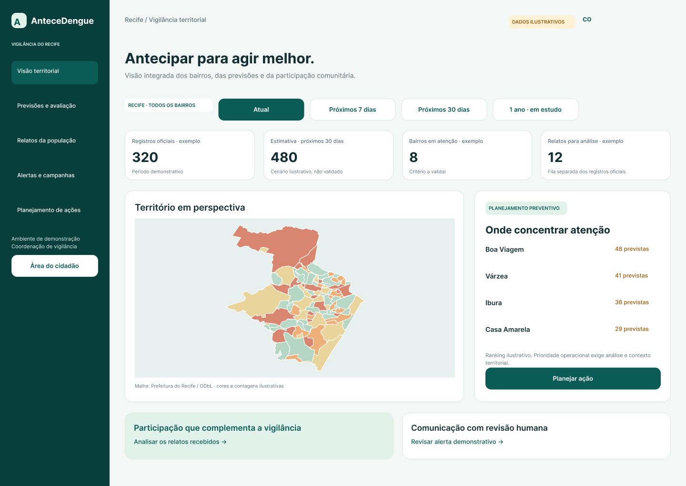

# AnteceDengue — Aplicação web de apoio à antecipação da dengue

O AnteceDengue estima quantas notificações de dengue podem ocorrer em cada bairro do Recife e em que período. A proposta é apoiar a priorização de ações preventivas e medir quanto chuva, temperatura e umidade acrescentam à previsão. O projeto nasceu do desafio [Limitações na Antecipação de Surtos de Dengue na Cidade do Recife](https://shiny-raindrop-cee689.netlify.app/), do Banco de Oportunidades.

## Acessos rápidos

- [Painel de apresentação](AV2/painel/abrir_painel.html) · [Como abrir, testar e reproduzir](AV2/README.md#requisitos-e-execução)
- [Google Drive](https://drive.google.com/drive/folders/1oQXWFYeC_-33eYTr_Q75-bXMiFFtg3yE?usp=sharing) · [Documentação completa da AV1 e AV2 (PDF)](AV2/documentos/Documentacao_AnteceDengue_AV1_AV2.pdf)
- [AV1 no Colab](https://colab.research.google.com/drive/1MpXxyiLApFqNRDW0AjeOK8G3z2Y053i6) · [AV2 no Colab](https://colab.research.google.com/github/7RICK0/Projeto_Dengue/blob/main/AV2/notebooks/AnteceDengue_AV2_modelagem.ipynb)

## Entregas

| ✅ Entrega 1 — Dados e análise exploratória | Entrega 2 — Previsão e avaliação |
|---|---|
| Limpamos e integramos notificações, clima e dados territoriais em uma base de 49.162 observações semanais de 94 bairros. A associação entre chuva acumulada e notificações enfraqueceu após descontar a sazonalidade. A AV1 revisada preparou os dados para testar o ganho do clima na AV2. | Comparamos modelos com e sem clima usando uma divisão por data. Para as próximas quatro semanas, o Gradient Boosting com clima teve erro médio de 2,88 notificações por bairro, contra 3,84 da média móvel e 2,98 do mesmo modelo sem clima. O efeito isolado do clima ainda é incerto. |
| [Documentação da AV1](AV1/README.md) · [Notebook revisado](AV1/notebooks/AnteceDengue_AV1_revisada.ipynb) · [Notebook original](AV1/notebooks/Projeto_AV1_Dengue_Recife_original.ipynb) | [Documentação da AV2](AV2/README.md) · [Relatório técnico (PDF)](AV2/documentos/Relatorio_AnteceDengue_AV2.pdf) · [Notebook executado](AV2/notebooks/AnteceDengue_AV2_modelagem.ipynb) |

## Painel, protótipo e acompanhamento

O painel mostra resultados históricos, previsões e consulta por bairro. Abra o HTML no navegador ou use **Executar tudo** no notebook da AV2 para ver o painel na primeira saída do Colab. O protótipo no Figma usa dados ilustrativos.

<table>
  <tr>
    <td width="50%" align="center" valign="top">
      
       
      <strong>Aplicação web — protótipo publicado</strong> 
      <small>Mapa e consulta territorial com dados ilustrativos.</small>
    </td>
    <td width="50%" align="center" valign="top">
      
       
      <strong>Planejamento no Trello</strong> 
      <small>Backlog, andamento e validação das entregas.</small>
    </td>
  </tr>
</table>
