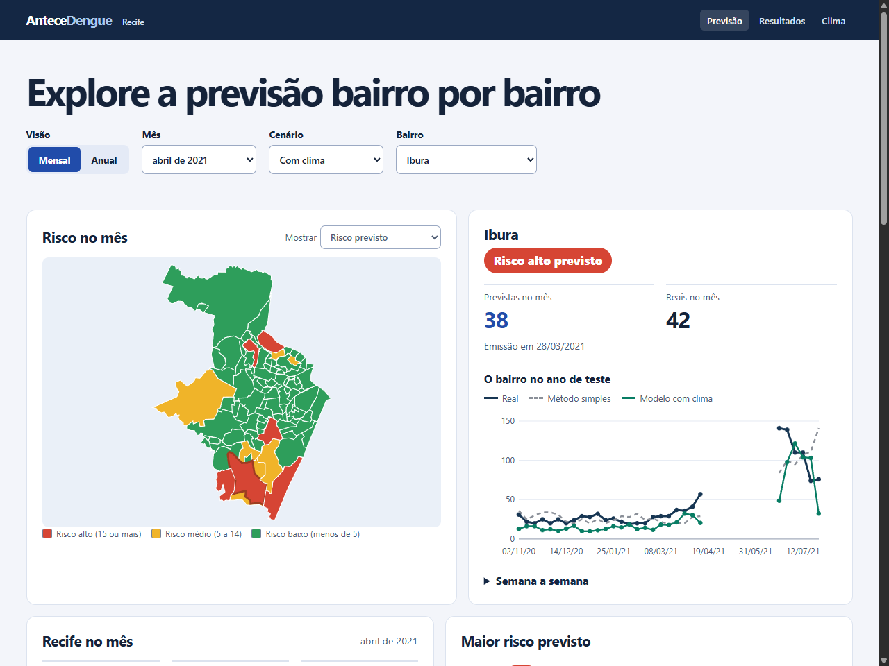

# AnteceDengue — Previsão de dengue nos bairros do Recife

**Aluno** Erick Acioli Belo · **Disciplina** Aprendizado de Máquina, CESAR School · **Professora** Chaina Oliveira

O AnteceDengue estima quantas notificações de dengue cada um dos 94 bairros do Recife pode ter nas próximas quatro semanas. A previsão ajuda a identificar onde priorizar ações preventivas antes de os registros aumentarem.

## Principais links

<table>
  <tr>
    <td width="34%" align="center" valign="top">
      <a href="https://colab.research.google.com/github/7RICK0/Projeto_Dengue/blob/main/AV2/notebooks/AnteceDengue_AV2_modelagem.ipynb">
        
      </a>
      <br>
      <strong>Painel da AV2 no Colab</strong><br>
      <small>Clique para abrir o notebook e selecione Executar tudo.</small>
    </td>
    <td width="33%" align="center" valign="top">
      <a href="https://check-detach-31150593.figma.site">
        
      </a>
      <br>
      <strong>Aplicação web — protótipo publicado</strong><br>
      <small>Mapa e consulta territorial com dados ilustrativos.</small>
    </td>
    <td width="33%" align="center" valign="top">
      <a href="https://trello.com/b/SBeFEpG9/antecedengue-av1-e-av2">
        
      </a>
      <br>
      <strong>Planejamento no Trello</strong><br>
      <small>Backlog, andamento e validação das entregas.</small>
    </td>
  </tr>
</table>

| Material | Acesso |
|---|---|
| **Notebook no Google Colab** | **[Abrir no Colab](https://colab.research.google.com/github/7RICK0/Projeto_Dengue/blob/main/AV2/notebooks/AnteceDengue_AV2_modelagem.ipynb)** |
| Documentação final | [Abrir PDF](AV2/documentos/Documentacao_AnteceDengue_AV1_AV2.pdf) |
| Painel web | [Como abrir o painel](#como-rodar) |
| Instruções de execução | [Como rodar](#como-rodar) |
| Pasta do projeto | [Google Drive](https://drive.google.com/drive/folders/1oQXWFYeC_-33eYTr_Q75-bXMiFFtg3yE?usp=sharing) |

## Entregas

| ✅ AV1 — Dados e análise exploratória | ✅ AV2 — Modelagem e previsão |
|---|---|
| Reuni notificações, clima e dados territoriais em uma base semanal por bairro. Na revisão, investiguei a relação entre o clima das semanas anteriores e as notificações. | Comparei modelos com e sem clima para prever notificações e avaliei os resultados em um período reservado. O painel mostra a previsão por bairro e permite compará-la com os registros observados. |
| [Documentação original da Entrega 1 (PDF)](AV1/docs/Documentacao_AV1_Dengue.pdf) · [Slides da apresentação (PDF)](AV1/slides/Apresentacao_AV1.pdf) | [Notebook executado](AV2/notebooks/AnteceDengue_AV2_modelagem.ipynb) · [Relatório técnico da AV2](AV2/documentos/Relatorio_AnteceDengue_AV2.pdf) |
| [README da AV1](AV1/README.md) · [Notebook original](AV1/notebooks/Projeto_AV1_Dengue_Recife_original.ipynb) · [Notebook revisado](AV1/notebooks/AnteceDengue_AV1_revisada.ipynb) · [AV1 no Colab](https://colab.research.google.com/drive/1MpXxyiLApFqNRDW0AjeOK8G3z2Y053i6) | [Protocolo usado na AV2](AV2/documentos/PROTOCOLO_EXPERIMENTAL.md) · [Planejamento e perguntas do projeto](AV2/documentos/PLANEJAMENTO_E_PERGUNTAS_AV2.md) |

## Arquitetura do projeto

```text
AnteceDengue/
├── README.md           ← apresentação, resultados e instruções do projeto
├── AV1/                ← dados, análise exploratória e preparação
│   ├── README.md       ← detalhes da primeira entrega
│   ├── docs/           ← documentação original da AV1
│   ├── slides/         ← apresentação da AV1
│   ├── notebooks/      ← versões original e revisada da análise
│   ├── dados/          ← dados de referência para a preparação
│   ├── artefatos/      ← base revisada, configuração e tabelas da análise
│   ├── scripts/        ← validação dos artefatos da AV1
│   └── requirements.txt  ← dependências Python do projeto
├── AV2/                ← modelagem, avaliação e painel
│   ├── documentos/     ← documentação final e materiais da AV2
│   │   ├── Documentacao_AnteceDengue_AV1_AV2.pdf  (completa, 21 páginas)
│   │   ├── Relatorio_AnteceDengue_AV2.pdf         (resumo, 8 páginas)
│   │   ├── PROTOCOLO_EXPERIMENTAL.md              (regras fixadas antes de modelar)
│   │   └── PLANEJAMENTO_E_PERGUNTAS_AV2.md        (as 8 perguntas do projeto)
│   ├── notebooks/      ← notebook executado da AV2
│   ├── painel/         ← painel web (abra abrir_painel.html)
│   ├── src/            ← código que o notebook e o painel usam
│   ├── artefatos/      ← previsões, métricas e gráficos
│   └── tests/          ← testes automáticos
└── prototype/          ← mapas do Recife e prévias do Figma e do Trello
```

1. **Dados da AV1.** A [base revisada](AV1/artefatos/dataset_av1_revisado.csv) chega pronta, com 49.162 linhas, uma por bairro e semana.
2. **Código.** O `src/` é a cozinha. Prepara os alvos, ou seja, os valores que pretendo prever, treina os modelos e calcula os resultados.
3. **Artefatos.** Os arquivos ZIP guardam métricas, previsões e um manifesto com os dados da execução. O teste final foi gravado uma única vez e sua reexecução está bloqueada.
4. **Notebook.** É o prato servido e explicado. Importa o código de `src/`, lê os artefatos e apresenta tabelas, gráficos e conclusões.
5. **Painel.** Mostra os mesmos resultados em um mapa de risco por bairro. O [exportador](AV2/src/exportar_painel.py) gera o arquivo [`painel/dados.js`](AV2/painel/dados.js) a partir dos artefatos.
6. **Testes.** São a inspeção. Verificam se a preparação evita o uso de dados do futuro, se os números batem e se o notebook rodado do zero reproduz as tabelas.
7. **Documentos.** A [Documentação final](AV2/documentos/Documentacao_AnteceDengue_AV1_AV2.pdf) detalha o que está resumido neste README.

**Fluxo** · dados da AV1 → `src/` (calcula) → `artefatos/` (guarda) → notebook e painel (mostram) → `tests/` (conferem)

## Resumo em um minuto

O **MAE** é o erro absoluto médio. Ele mede, em média, a distância entre o número previsto e o observado, em notificações por bairro.

| Teste das próximas quatro semanas | MAE |
|---|---:|
| Média móvel das semanas recentes | 3,835 |
| Gradient Boosting sem clima | 2,978 |
| **Gradient Boosting com clima** | **2,882** |

O ganho de usar aprendizado de máquina foi sólido no teste: o Gradient Boosting com clima reduziu o erro em **24,9%** frente à média móvel. Acrescentar clima ao mesmo modelo reduziu o erro em **3,2%**, um ganho provável, ainda sem comprovação estatística. Chuva e umidade costumam subir antes de as notificações aumentarem. O principal ponto fraco foi estimar o tamanho dos surtos, pois o modelo tende a subestimar os picos.

## De onde veio

O projeto nasceu do desafio público **Limitações na Antecipação de Surtos de Dengue na Cidade do Recife**, divulgado pelo Banco de Oportunidades. Quando o aumento aparece nos registros, a vigilância tem menos tempo para organizar a prevenção. [Ver desafio original](https://shiny-raindrop-cee689.netlify.app/)

- **AV1.** Reuni notificações, clima e território em uma base por bairro e semana. A associação entre chuva acumulada e notificações enfraqueceu após descontar a sazonalidade, ou seja, os padrões recorrentes ao longo do ano.
- **Revisão da AV1.** Padronizei os arquivos anuais, revisei duplicatas e registros com datas divergentes e documentei como cada variável foi calculada. A base distingue semanas sem cobertura de semanas com zero notificações. [Ver AV1 revisada](AV1/README.md)
- **AV2.** Usei essa base para testar a previsão e medir quanto o clima acrescenta ao histórico de notificações.

## Pergunta e objetivo

**Chuva, temperatura e umidade ajudam a prever a quantidade de notificações por bairro além das informações disponíveis no histórico, no calendário e no território?**

Equipes de vigilância e controle de vetores podem consultar os resultados para priorizar visitas, inspeções e ações preventivas. O alvo é a contagem de **notificações de dengue A90** na base de vigilância. Uma notificação é um registro sujeito a investigação e pode não corresponder a um caso confirmado.

## Dados

| Fonte | O que forneceu |
|---|---|
| [Prefeitura do Recife — registros de arboviroses](https://dados.recife.pe.gov.br/dataset/casos-de-dengue-zika-e-chikungunya) | Notificações usadas para construir as contagens semanais de dengue. |
| [INMET — dados meteorológicos históricos](https://portal.inmet.gov.br/dadoshistoricos) | Chuva, temperatura e umidade da estação A301 no Recife. |
| [Prefeitura do Recife — área urbana](https://dados.recife.pe.gov.br/dataset/area-urbana) | Bairros, regiões administrativas e limites para o mapa. |
| [CIEVS Recife — população por bairro](https://cievsrecife.files.wordpress.com/2017/11/populac3a7c3a3o-2010-a-2017-uvepi1.pdf) · [IBGE — Censo por bairro](https://ftp.ibge.gov.br/Censos/Censo_Demografico_2022/Agregados_por_Setores_Censitarios/Agregados_por_Bairro_xlsx/) · [IBGE — estimativas municipais](https://sidra.ibge.gov.br/tabela/6579) | Referências populacionais da AV1. População e densidade ficaram fora da comparação principal por falta de cobertura histórica disponível à época das previsões. |

A base revisada reúne **49.162 observações**. A comparação direta com e sem clima usa **20.304 observações** de semanas com as entradas necessárias, entre **2016 e 2021**.

## Como fiz

1. **Planejei antes de modelar.** O protocolo definiu os alvos, a métrica, os cortes e a regra de escolha. [Ver protocolo usado na AV2](AV2/documentos/PROTOCOLO_EXPERIMENTAL.md)
2. **Dividi por data.** O treino usa o período mais antigo. A validação usa datas posteriores para escolher a configuração. O período final ficou reservado para conferir o desempenho. Uma janela de quatro semanas precisa caber inteira em uma só divisão.
3. **Comparei com e sem clima nas mesmas linhas.** As duas versões usam o mesmo histórico, calendário e território. A versão com clima acrescenta chuva, temperatura e umidade. As defasagens são medidas de semanas anteriores disponíveis no momento da previsão.
4. **Treinei os candidatos e usei referências simples.** A regressão de Poisson modela contagens. Random Forest combina várias árvores de decisão, e Gradient Boosting ajusta árvores em sequência para reduzir erros. A persistência repete a contagem recente, e a média móvel usa a média das semanas recentes.
5. **Medi o erro.** Usei o MAE para comparar as previsões por bairro e examinei também o erro no total da cidade e nos picos.
6. **Escolhi na validação e avaliei no teste.** O Gradient Boosting teve o menor MAE entre os candidatos de aprendizado de máquina na validação. A configuração foi definida antes de abrir os resultados reservados.

O **teste final foi usado uma única vez**. Os scripts `avaliar_teste_final.py` e `avaliar_mes_calendario.py` se recusam a rodar de novo quando os resultados já existem, de propósito. O notebook lê as previsões salvas. [Ver inventário dos artefatos](AV2/artefatos/README.md)

## Por que usei código e testes além do Colab

Usei o VS Code para organizar o código reutilizável em arquivos `.py`. O notebook reúne as explicações e os resultados, e os testes verificam os alvos, a divisão temporal e a correspondência entre as previsões salvas e o painel. A trava dos scripts protege a avaliação reservada. O painel permite explorar os resultados por bairro no navegador.

## Resultados principais

A análise de incerteza por **bootstrap**, que reamostra blocos de semanas do teste, encontrou ganho por bairro ao incluir clima em cerca de **87%** dos sorteios. O intervalo de **95%** inclui zero. Isso indica um possível benefício, com incerteza sobre sua repetição em outros períodos. [Ver análise no relatório](AV2/documentos/Relatorio_AnteceDengue_AV2.pdf)

### Até onde confiar na previsão

| Pergunta | O que os resultados sustentam |
|---|---|
| **Quando o risco sobe?** | Na série histórica da cidade, chuva e umidade estiveram associadas às notificações de **quatro a seis semanas depois**. Esse sinal ajuda a observar períodos de aumento. |
| **Onde agir primeiro?** | No mês de calendário, a versão com clima incluiu em média **5,4 dos 10 bairros** com mais notificações, contra **4,7** da média móvel. A lista serve como ponto de partida para a vigilância. |
| **Quanto pode aumentar?** | As maiores altas são mais difíceis de estimar. Em uma janela no Ibura, o modelo previu cerca de **49** notificações e foram registradas **141**. |

A janela móvel de quatro semanas começa depois de cada emissão. O **mês de calendário** tem datas fixas e avaliação própria. A estimativa anual é complementar e usa o histórico de notificações sem clima.

## Perguntas respondidas

### As oito perguntas do projeto

| Pergunta | Resposta |
|---|---|
| Quando? | O horizonte principal cobre as próximas quatro semanas. A próxima semana foi avaliada separadamente. |
| Onde? | O painel mostra a previsão por bairro e permite comparar os bairros prioritários. |
| Quanto? | A saída é uma contagem prevista de notificações no período selecionado. |
| O clima ajuda? | A comparação nas mesmas observações mostrou uma melhora adicional, ainda inconclusiva. |
| Quais atrasos climáticos importam? | A umidade de sete a oito semanas antes se destacou na análise de importância. |
| O resultado se sustenta no futuro? | O teste usou observações posteriores às da validação. Falta confirmar o desempenho em outros períodos com clima. |
| A saída é territorialmente útil? | O mapa e a lista por bairro ajudam a ordenar visitas e acompanhar os valores observados. |
| Quais são as limitações? | Cobertura climática, atrasos dos registros, período de teste e dificuldade nos picos. |

[Ver planejamento e perguntas do projeto](AV2/documentos/PLANEJAMENTO_E_PERGUNTAS_AV2.md)

### As onze perguntas da professora

| Pergunta | Resposta |
|---|---|
| Qual problema quero resolver? | Antecipar aumentos de notificações para que o Recife possa planejar a prevenção por bairro. |
| Que dados utilizei? | Notificações oficiais, dados da estação meteorológica e informações territoriais. |
| O que descobri nos dados? | Chuva e umidade sobem antes das notificações, e a força da associação varia com o período. |
| Como preparei os dados? | Limpei duplicatas e datas, agreguei por bairro e semana e calculei históricos e defasagens. |
| Quais modelos testei? | Regressão de Poisson, Random Forest e Gradient Boosting. |
| Como comparei os modelos? | Com divisão por data, referências simples e cenários com e sem clima nas mesmas linhas. |
| Qual métrica escolhi? | MAE, porque expressa o erro em notificações por bairro. |
| Qual foi o melhor modelo? | Gradient Boosting com clima para as próximas quatro semanas. |
| Por que ele foi escolhido? | Teve o menor MAE entre os candidatos de aprendizado de máquina na validação. |
| Quais são suas limitações? | Uma estação climática, teste no período da pandemia e subestimação de picos. |
| Quais são as oportunidades de melhoria? | Ampliar a cobertura climática, testar em períodos novos e estimar faixas de previsão. |

O notebook segue a sequência **Modelagem → Experimentos → Avaliação → Modelo final → Conclusões**.

## Limitações e melhorias

- **Cobertura climática.** Uma estação representa toda a cidade. Mais anos de dados e medições em outros locais ajudariam a avaliar diferenças entre bairros.
- **Período de teste.** O teste ocorreu durante a pandemia de COVID-19, quando a procura por atendimento e os registros podem ter mudado. Um novo teste fora desse período ajudaria a verificar se o ganho do clima se repete.
- **Disponibilidade dos registros.** A série histórica foi consolidada. Para uso operacional, é preciso avaliar o que já estava disponível na data real da emissão.
- **Picos.** Dados de infestação do mosquito e previsões em faixa podem ajudar a planejar ações quando o volume esperado é mais incerto.

<a name="requisitos-e-execução"></a>

## Como rodar

**No Colab**, abra o [notebook](https://colab.research.google.com/github/7RICK0/Projeto_Dengue/blob/main/AV2/notebooks/AnteceDengue_AV2_modelagem.ipynb) e use **Ambiente de execução → Executar tudo**. A primeira célula de código baixa o repositório quando necessário e exibe o painel.

**No navegador**, abra `AV2/painel/abrir_painel.html` na cópia local. O painel funciona offline.

**No PC**, execute na raiz do repositório:

```powershell
python -m pip install -r AV1/requirements.txt
python -B -m unittest discover -s AV2/tests -t .
python -B AV2/tests/rodar_notebook_do_zero.py
```
