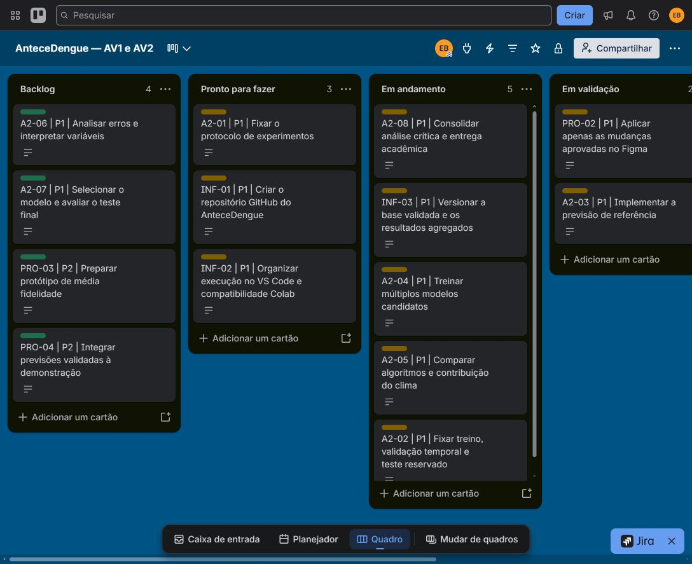

# AnteceDengue

**Aprendizado de Máquina para antecipação territorial de casos notificados de dengue no Recife.**

O AnteceDengue investiga se a integração entre histórico epidemiológico, clima e território pode indicar **onde**, **quando** e **quanto** os casos notificados de dengue poderão aumentar. A proposta é apoiar a priorização de ações preventivas antes do crescimento observado dos registros.

> **Pergunta central:** é possível antecipar a quantidade de casos notificados de dengue por bairro do Recife usando dados disponíveis até o momento da previsão?

## Acessos rápidos

| Recurso | Acesso |
|---|---|
| Origem do projeto | [Desafio no Banco de Oportunidades do Recife](https://shiny-raindrop-cee689.netlify.app/) |
| Arquivos compartilhados | [Pasta do projeto no Google Drive](https://drive.google.com/drive/folders/1oQXWFYeC_-33eYTr_Q75-bXMiFFtg3yE?usp=sharing) |
| Notebook em nuvem | [AV1 no Google Colab](https://colab.research.google.com/drive/1MpXxyiLApFqNRDW0AjeOK8G3z2Y053i6) |
| Notebook revisado | [`AnteceDengue_AV1_revisada.ipynb`](AV1/notebooks/AnteceDengue_AV1_revisada.ipynb) |
| Notebook original | [`Projeto_AV1_Dengue_Recife_original.ipynb`](AV1/notebooks/Projeto_AV1_Dengue_Recife_original.ipynb) |
| Documentação da Entrega 1 | [`AV1/README.md`](AV1/README.md) |
| Planejamento da Entrega 2 | [`PLANEJAMENTO_E_PERGUNTAS_AV2.md`](AV2/docs/PLANEJAMENTO_E_PERGUNTAS_AV2.md) |

> A versão revisada e validada da Entrega 1 neste repositório é a referência técnica atual. A cópia do Colab deve ser sincronizada separadamente quando houver atualização externa autorizada.

## Origem e problema enfrentado

O projeto nasceu do desafio público **“Limitações na Antecipação de Surtos de Dengue na Cidade do Recife”**, publicado em 23/01/2026 no Banco de Oportunidades do Recife.

O desafio aponta que Recife dispõe de dados epidemiológicos, ambientais e operacionais, mas ainda enfrenta limitações para analisá-los de forma integrada e preditiva. Como consequência, parte das ações de controle ocorre quando os casos já estão crescendo.

O AnteceDengue transforma esse problema em uma tarefa verificável de Machine Learning:

1. organizar registros oficiais por bairro e semana;
2. representar chuva, temperatura, umidade, sazonalidade e histórico epidemiológico;
3. prever a quantidade futura de casos notificados;
4. identificar bairros e períodos que merecem atenção preventiva;
5. comunicar resultados, erros e limitações sem apresentar a ferramenta como alerta epidemiológico oficial.

## Protótipo e planejamento

Clique nas imagens para abrir os ambientes do projeto.

<table>
  <tr>
    <td width="50%" align="center">
      <a href="https://check-detach-31150593.figma.site">
        
      </a>
      <br>
      <strong>Protótipo publicado</strong><br>
      Mapa, consulta territorial e apoio à priorização. Os valores atuais são ilustrativos até a integração com a AV2.
    </td>
    <td width="50%" align="center">
      <a href="https://trello.com/b/SBeFEpG9/antecedengue-av1-e-av2">
        
      </a>
      <br>
      <strong>Planejamento no Trello</strong><br>
      Backlog, tarefas em andamento, validação e acompanhamento das duas entregas.
    </td>
  </tr>
</table>

## ✅ Entrega 1 — Fundamentos, dados e preparação concluídos

A Entrega 1 estabelece uma base confiável para a modelagem. A versão original foi preservada e a revisão técnica corrigiu inconsistências, reforçou a rastreabilidade e aprofundou a investigação da hipótese climática.

### Escopo técnico realizado

- aquisição de notificações de dengue, Zika e chikungunya no Portal de Dados Abertos do Recife;
- seleção e validação do agravo de dengue (`A90`);
- limpeza de datas, bairros, identificadores, classificações e duplicidades;
- preservação auditável de registros divergentes, sem remoção automática indevida;
- agregação das notificações na unidade **bairro-semana**;
- integração com a malha de bairros da Prefeitura do Recife;
- integração de população e área por bairro com dados do Censo 2022;
- integração de chuva, temperatura e umidade da estação A301 do INMET;
- conversão dos registros climáticos horários para a semana local do Recife;
- controle de qualidade exigindo cobertura mínima de 90% das horas esperadas;
- criação de atributos temporais, epidemiológicos, territoriais e climáticos;
- separação cronológica entre treino, validação e teste;
- demonstração de codificação, escalonamento e preprocessamento ajustados apenas no treino;
- análise exploratória restrita ao período de treino;
- geração de dataset, manifesto, configuração, relatórios e preprocessadores reproduzíveis.

### Engenharia de atributos

Foram construídos atributos disponíveis no momento da previsão, evitando o uso de informações futuras:

- histórico de casos notificados do próprio bairro;
- médias e tendências epidemiológicas recentes;
- mês e componentes sazonais;
- população, área, densidade e identificação territorial;
- chuva, temperatura e umidade com defasagens de uma a oito semanas;
- chuva acumulada e médias climáticas em janelas de duas, quatro e oito semanas;
- alvo inicial: quantidade de casos notificados no mesmo bairro na semana seguinte.

### Dimensão da base revisada

| Indicador | Resultado |
|---|---:|
| Registros brutos adquiridos | 71.663 |
| Registros epidemiológicos válidos após limpeza | 71.175 |
| Linhas no painel bairro-semana | 49.162 |
| Bairros representados | 94 |
| Colunas do dataset preparado | 69 |
| Linhas com coorte climática completa | 20.304 |
| Período comum com clima completo | 25/04/2016 a 08/11/2021 |

### O que a análise exploratória mostrou

A revisão encontrou um sinal climático promissor, principalmente para chuva acumulada:

- chuva semanal com duas semanas de antecedência: Pearson de aproximadamente `0,155`;
- chuva semanal com quatro semanas de antecedência: Spearman de aproximadamente `0,416`;
- chuva acumulada em oito semanas: Pearson `0,618` e Spearman `0,631` com o total municipal da semana seguinte;
- depois de retirar as médias mensais, o Pearson da chuva acumulada em oito semanas caiu para `0,218`;
- a intensidade da associação variou entre os anos analisados.

Assim, a resposta da Entrega 1 é **parcialmente positiva e exploratória**: há evidência suficiente para testar o clima na modelagem, mas correlação não prova causalidade nem garante ganho preditivo.

### Validação e rastreabilidade

- notebook revisado com 56 células, sendo 27 células de código executadas sem erro;
- artefatos vinculados à execução de 17/11/2026;
- validador reproduzível em [`AV1/scripts/validar_artefatos.py`](AV1/scripts/validar_artefatos.py);
- resultado da validação: `VALIDACAO_OK linhas=49162 colunas=69 coorte=20304`;
- dados pessoais e identificadores individuais não são exportados no dataset agregado;
- documentação completa, decisões e limitações em [`AV1/README.md`](AV1/README.md).

## 🚧 Entrega 2 — Modelagem e avaliação em início

A Entrega 2 deverá verificar se os sinais encontrados na AV1 realmente ajudam a prever períodos futuros. O foco inicial é estimar a **quantidade de casos notificados por bairro na semana seguinte**.

### Modelagem proposta

- **tipo de aprendizado:** supervisionado;
- **tipo de problema:** regressão de contagem;
- **candidato principal:** Random Forest Regressor;
- **comparações:** referência ingênua, Regressão de Poisson, Árvore de Decisão e Gradient Boosting;
- **métrica principal proposta:** MAE;
- **métrica complementar:** RMSE;
- **validação:** divisão temporal, mantendo semanas futuras fora do treinamento;
- **experimento central:** os mesmos modelos, linhas e períodos comparados com e sem clima.

O modelo final não será escolhido antecipadamente. Random Forest é o principal candidato, mas a seleção dependerá do desempenho, da estabilidade, da interpretação dos erros e da capacidade de generalizar para períodos posteriores.

### Perguntas que a Entrega 2 precisa responder

1. Com quanta antecedência é possível estimar aumentos?
2. Quais bairros apresentam maior quantidade prevista ou risco de aumento?
3. Quantos casos notificados são esperados no horizonte avaliado?
4. Chuva, temperatura e umidade melhoram a previsão?
5. Quais atrasos e janelas climáticas acrescentam informação útil?
6. O desempenho se sustenta em períodos futuros não utilizados no treinamento?
7. A saída permite priorização territorial preventiva?
8. Quais limitações condicionam o uso responsável dos resultados?

O protocolo detalhado está em [`AV2/docs/PLANEJAMENTO_E_PERGUNTAS_AV2.md`](AV2/docs/PLANEJAMENTO_E_PERGUNTAS_AV2.md).

## Estrutura principal

```text
Projeto_Dengue/
├── AV1/
│   ├── notebooks/       # notebook original e versão revisada
│   ├── artefatos/       # dataset agregado, relatórios e preprocessadores
│   ├── scripts/         # validação reproduzível
│   ├── docs/            # documentos da primeira entrega
│   ├── slides/          # apresentação da primeira entrega
│   └── README.md        # relatório técnico detalhado da AV1
├── AV2/
│   └── docs/            # planejamento, perguntas e documentação beta
├── prototype/           # prévias e documentação do protótipo
└── README.md            # visão geral e andamento do projeto
```

## Limites de interpretação

- “Casos notificados” são registros de vigilância e não equivalem necessariamente a casos confirmados ou pessoas únicas.
- As correlações da AV1 são exploratórias e não comprovam causalidade.
- O protótipo ainda utiliza valores ilustrativos e não representa alerta epidemiológico oficial.
- Horizontes maiores que uma semana exigirão alvos, dados e validações próprios.
- O uso operacional dependerá de qualidade dos dados, atualização, cobertura territorial e revisão por profissionais responsáveis.
