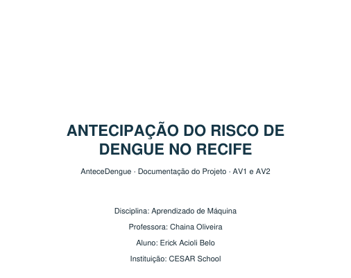

# AnteceDengue — Previsão de dengue nos bairros do Recife

[](https://github.com/7RICK0/Projeto_Dengue/actions/workflows/ci.yml)
[](https://www.python.org/)
[](https://pandas.pydata.org/)
[](https://scikit-learn.org/)
[](https://colab.research.google.com/github/7RICK0/Projeto_Dengue/blob/main/AV2/notebooks/AnteceDengue_AV2_modelagem.ipynb)
[](AV2/painel/abrir_painel.html)

**Aluno** Erick Acioli Belo · **Instituição** CESAR School · **Disciplina** Aprendizado de Máquina · **Professora** Chaina Oliveira

O AnteceDengue é um projeto de aprendizado de máquina que estima quantas notificações de dengue podem ser registradas em cada um dos 94 bairros do Recife nas próximas quatro semanas. Uma notificação é um registro de suspeita feito pela vigilância em saúde. A confirmação depende de investigação.

A previsão usa o histórico de notificações, o calendário e informações dos bairros. Na AV2, comparei o desempenho com e sem dados de chuva, temperatura e umidade para medir quanto o clima ajuda. O painel mostra as previsões ao lado dos registros observados e ajuda a identificar onde priorizar visitas e outras ações preventivas.

## Principais links

<table>
  <tr>
    <td width="34%" align="center" valign="top">
      <a href="https://colab.research.google.com/github/7RICK0/Projeto_Dengue/blob/main/AV2/notebooks/AnteceDengue_AV2_modelagem.ipynb">
        
      </a>
      <br>
      <strong>Painel da AV2 no Colab</strong><br>
      <small>Clique para abrir o notebook e selecione Executar tudo.</small>
    </td>
    <td width="33%" align="center" valign="top">
      <a href="https://check-detach-31150593.figma.site">
        
      </a>
      <br>
      <strong>Aplicação web — protótipo publicado</strong><br>
      <small>Mapa e consulta territorial com dados ilustrativos.</small>
    </td>
    <td width="33%" align="center" valign="top">
      <a href="https://trello.com/b/SBeFEpG9/antecedengue-av1-e-av2">
        
      </a>
      <br>
      <strong>Planejamento no Trello</strong><br>
      <small>Backlog, andamento e validação das entregas.</small>
    </td>
  </tr>
</table>

<table>
  <tr>
    <td width="50%" align="center" valign="middle">
      <a href="AV2/documentos/Documentacao_AnteceDengue_AV1_AV2.pdf">
        
      </a>
      <br>
      <strong>Documentação final</strong>
    </td>
    <td width="50%" align="center" valign="middle">
      <a href="https://drive.google.com/drive/folders/1oQXWFYeC_-33eYTr_Q75-bXMiFFtg3yE?usp=sharing">
        
      </a>
      <br>
      <strong>Google Drive</strong>
    </td>
  </tr>
</table>

## Entregas

| ✅ AV1 — Dados e análise exploratória | ✅ AV2 — Modelagem e previsão |
|---|---|
| Reuni notificações, clima e dados territoriais em uma base semanal por bairro. Na revisão, investiguei a relação entre o clima das semanas anteriores e as notificações. | Comparei modelos com e sem clima para prever notificações e avaliei os resultados em um período reservado. O painel mostra a previsão por bairro e permite compará-la com os registros observados. |
| [Documentação original da Entrega 1 (PDF)](AV1/documentos/Documentacao_AV1_Dengue.pdf) · [Slides da apresentação (PDF)](AV1/slides/Apresentacao_AV1.pdf) | [Notebook executado](AV2/notebooks/AnteceDengue_AV2_modelagem.ipynb) · [Relatório técnico da AV2](AV2/documentos/Relatorio_AnteceDengue_AV2.pdf) |
| [Notebook original](AV1/notebooks/Projeto_AV1_Dengue_Recife_original.ipynb) · [Notebook revisado](AV1/notebooks/AnteceDengue_AV1_revisada.ipynb) · [AV1 no Colab](https://colab.research.google.com/github/7RICK0/Projeto_Dengue/blob/main/AV1/notebooks/AnteceDengue_AV1_revisada.ipynb) | [Protocolo usado na AV2](AV2/documentos/PROTOCOLO_EXPERIMENTAL.md) |

## Arquitetura do projeto

```text
AnteceDengue/
├── README.md
├── .github/workflows/                              ← verificação automática (CI) a cada envio ao GitHub
├── AV1/                                            ← preparação dos dados e análise exploratória
│   ├── documentos/
│   ├── slides/
│   ├── notebooks/
│   ├── dados/                                      ← população por bairro (CIEVS, 2010–2017)
│   ├── artefatos/                                  ← base revisada usada na AV2
│   ├── scripts/                                    ← validador que confere a integridade da base
│   └── requirements.txt
├── AV2/                                            ← modelagem e avaliação
│   ├── documentos/
│   │   ├── Documentacao_AnteceDengue_AV1_AV2.pdf   ← projeto completo, da AV1 à AV2
│   │   ├── Relatorio_AnteceDengue_AV2.pdf          ← resumo técnico da AV2
│   │   └── PROTOCOLO_EXPERIMENTAL.md               ← regras fixadas antes de modelar
│   ├── notebooks/
│   ├── painel/                                     ← painel web com o mapa de risco por bairro
│   ├── src/                                        ← código que prepara, treina e avalia os modelos
│   ├── artefatos/                                  ← previsões e métricas registradas (teste final travado)
│   └── tests/                                      ← testes automáticos contra erros e vazamento de dados
└── prototype/                                      ← mapas do Recife e prévias do Figma e do Trello
```

1. **Dados da AV1.** A [base revisada](AV1/artefatos/dataset_av1_revisado.csv) chega pronta, com 49.162 linhas, uma por bairro e semana.
2. **Código.** O `src/` é a cozinha. Prepara os alvos, ou seja, os valores que pretendo prever, treina os modelos e calcula os resultados.
3. **Artefatos.** Os arquivos ZIP guardam métricas, previsões e um manifesto com os dados da execução. O teste final foi gravado uma única vez e sua reexecução está bloqueada.
4. **Notebook.** É o prato servido e explicado. Importa o código de `src/`, lê os artefatos e apresenta tabelas, gráficos e conclusões.
5. **Painel.** Mostra os mesmos resultados em um mapa de risco por bairro. O [exportador](AV2/src/exportar_painel.py) gera o arquivo [`painel/dados.js`](AV2/painel/dados.js) a partir dos artefatos.
6. **Testes.** São a inspeção. Verificam se a preparação evita o uso de dados do futuro, se os números batem e se o notebook rodado do zero reproduz as tabelas.
7. **Documentos.** A [Documentação final](AV2/documentos/Documentacao_AnteceDengue_AV1_AV2.pdf) detalha o que está resumido neste README.

**Fluxo** · dados da AV1 → `src/` (calcula) → `artefatos/` (guarda) → notebook e painel (mostram) → `tests/` (conferem)

## Sumário

- [Resumo em um minuto](#resumo-em-um-minuto)
- [De onde veio](#de-onde-veio)
- [Pergunta e objetivo](#pergunta-e-objetivo)
- [Dados](#dados)
- [Como fiz](#como-fiz)
- [O que fiz além do que foi pedido, e por quê](#o-que-fiz-além-do-que-foi-pedido-e-por-quê)
- [Resultados principais](#resultados-principais)
- [Perguntas respondidas](#perguntas-respondidas)
- [Limitações e melhorias](#limitações-e-melhorias)
- [Como rodar](#como-rodar)

## Resumo em um minuto

Para planejar ações de prevenção no Recife, é útil saber quais bairros podem ter mais notificações de dengue nas próximas semanas. Na AV2, investiguei duas perguntas: um modelo de aprendizado de máquina consegue prever melhor do que usar a média das semanas recentes? Acrescentar chuva, temperatura e umidade melhora a previsão do mesmo modelo?

Para responder, comparei as três opções nas mesmas semanas e bairros, em um período reservado para o teste. O **MAE**, ou erro absoluto médio, mostra quanto a previsão se distanciou da contagem observada, em média. Quanto menor o valor, mais próxima ficou a previsão.

| Previsão para as próximas quatro semanas | Erro médio em notificações por bairro (MAE) |
|---|---:|
| Média móvel das semanas recentes | 3,835 |
| Gradient Boosting sem clima | 2,978 |
| **Gradient Boosting com clima** | **2,882** |

O modelo com clima reduziu o erro em **24,9% em relação à média móvel**. Quando comparei as duas versões do mesmo modelo, acrescentar clima reduziu o erro em mais **3,2%**. Esse ganho adicional ainda é incerto: seria preciso verificar se ele aparece em outros períodos.

Na prática, chuva e umidade podem ajudar a indicar **quando reforçar a atenção**, porque na série histórica elas subiram antes das notificações. A previsão ainda tende a subestimar os maiores picos. O painel permite explorar esses resultados por bairro e comparar as previsões com o que foi observado.

## De onde veio

O projeto nasceu do desafio público **Limitações na Antecipação de Surtos de Dengue na Cidade do Recife**, divulgado pelo Banco de Oportunidades. Quando o aumento aparece nos registros, a vigilância tem menos tempo para organizar a prevenção. [Ver desafio original](https://shiny-raindrop-cee689.netlify.app/)

- **AV1.** Reuni notificações, clima e território em uma base por bairro e semana. A associação entre chuva acumulada e notificações enfraqueceu após descontar a sazonalidade, ou seja, os padrões recorrentes ao longo do ano.
- **Revisão da AV1.** Padronizei os arquivos anuais, revisei duplicatas e registros com datas divergentes e documentei como cada variável foi calculada. A base distingue semanas sem cobertura de semanas com zero notificações. [Ver notebook revisado](AV1/notebooks/AnteceDengue_AV1_revisada.ipynb)
- **AV2.** Usei essa base para testar a previsão e medir quanto o clima acrescenta ao histórico de notificações.

## Pergunta e objetivo

**Chuva, temperatura e umidade ajudam a prever a quantidade de notificações por bairro além das informações disponíveis no histórico, no calendário e no território?**

Equipes de vigilância e controle de vetores podem consultar os resultados para priorizar visitas, inspeções e ações preventivas. O alvo é a contagem de **notificações de dengue A90** na base de vigilância.

## Dados

| Fonte | O que forneceu |
|---|---|
| [Prefeitura do Recife — registros de arboviroses](https://dados.recife.pe.gov.br/dataset/casos-de-dengue-zika-e-chikungunya) | Notificações usadas para construir as contagens semanais de dengue. |
| [INMET — dados meteorológicos históricos](https://portal.inmet.gov.br/dadoshistoricos) | Chuva, temperatura e umidade da estação A301 no Recife. |
| [Prefeitura do Recife — área urbana](https://dados.recife.pe.gov.br/dataset/area-urbana) | Bairros, regiões administrativas e limites para o mapa. |
| [CIEVS Recife — população por bairro](https://cievsrecife.files.wordpress.com/2017/11/populac3a7c3a3o-2010-a-2017-uvepi1.pdf) · [IBGE — Censo por bairro](https://ftp.ibge.gov.br/Censos/Censo_Demografico_2022/Agregados_por_Setores_Censitarios/Agregados_por_Bairro_xlsx/) · [IBGE — estimativas municipais](https://sidra.ibge.gov.br/tabela/6579) | Referências populacionais da AV1. População e densidade ficaram fora da comparação principal por falta de cobertura histórica disponível à época das previsões. |

A base revisada reúne **49.162 observações**. A comparação direta com e sem clima usa **20.304 observações** de semanas com as entradas necessárias, entre **2016 e 2021**.

## Como fiz

1. **Planejei antes de modelar.** O protocolo definiu os alvos, a métrica, os cortes e a regra de escolha. [Ver protocolo usado na AV2](AV2/documentos/PROTOCOLO_EXPERIMENTAL.md)
2. **Dividi por data.** O treino usa o período mais antigo. A validação usa datas posteriores para escolher a configuração. O período final ficou reservado para conferir o desempenho. Uma janela de quatro semanas precisa caber inteira em uma só divisão.
3. **Comparei com e sem clima nas mesmas linhas.** As duas versões usam o mesmo histórico, calendário e território. A versão com clima acrescenta chuva, temperatura e umidade. As defasagens são medidas de semanas anteriores disponíveis no momento da previsão.
4. **Treinei os candidatos e usei referências simples.** A regressão de Poisson modela contagens. Random Forest combina várias árvores de decisão, e Gradient Boosting ajusta árvores em sequência para reduzir erros. A persistência repete a contagem recente, e a média móvel usa a média das semanas recentes.
5. **Medi o erro.** Usei o MAE para comparar as previsões por bairro e examinei também o erro no total da cidade e nos picos.
6. **Escolhi na validação e avaliei no teste.** O Gradient Boosting teve o menor MAE entre os candidatos de aprendizado de máquina na validação. A configuração foi definida antes de abrir os resultados reservados.

O **teste final foi usado uma única vez**. Os scripts `avaliar_teste_final.py` e `avaliar_mes_calendario.py` se recusam a rodar de novo quando os resultados já existem, de propósito. O notebook lê as previsões salvas. [Ver inventário dos artefatos](AV2/artefatos/README.md)

## O que fiz além do que foi pedido, e por quê

O pedido da AV2 foi um notebook de modelagem e avaliação, a documentação e a apresentação. Tudo isso está completo e funciona sem o restante. Mesmo assim, quis ir além por três motivos: **conferir que os resultados estão certos**, **permitir que qualquer pessoa repita o experimento** e **mostrar como a previsão seria usada na prática**. Cada item abaixo existe por um desses motivos.

| O que acrescentei | O que é | Por que fiz | O que acrescenta ao projeto |
|---|---|---|---|
| **Código em arquivos `.py`** (`AV2/src/`) | As contas (preparar os dados, treinar e avaliar os modelos) ficam em arquivos Python que o notebook importa. Usei o VS Code para organizá-los | Evitar copiar o mesmo código em várias células e arquivos, o que gera versões diferentes da mesma conta | Uma só versão de cada conta, usada pelo notebook, pelo painel e pelos testes. O notebook fica mais limpo para ler |
| **Testes automáticos** (`AV2/tests/`) | Programas que conferem sozinhos se o trabalho está certo ([detalhes abaixo](#o-que-os-testes-verificam)) | Um erro pequeno, como usar dados do futuro, deixaria os resultados bonitos e falsos sem ninguém perceber | Provam que os números não têm vazamento de dados e batem com o que foi salvo |
| **Teste final travado** | Os scripts `avaliar_teste_final.py` e `avaliar_mes_calendario.py` se recusam a rodar de novo | Rodar o teste várias vezes e ficar com o melhor resultado invalidaria a avaliação | Garante que o período reservado foi usado uma única vez |
| **Resultados gravados com manifesto** (`AV2/artefatos/`) | Métricas e previsões salvas em arquivos, com data, versões e parâmetros da execução | O notebook precisa abrir rápido, e os números oficiais não podem mudar a cada execução | Qualquer número pode ser conferido depois, e o notebook roda em poucos minutos |
| **Painel web** (`AV2/painel/`) | Página com mapa de risco por bairro, que abre no navegador sem internet | A AV1 previa uma aplicação para gestores, e tabelas não mostram onde agir primeiro | Mostra o resultado como a vigilância o usaria e serve de demonstração |
| **Verificação automática no GitHub** (`.github/workflows/`) | O GitHub confere a base e roda os testes numa máquina limpa a cada envio | Provar que o projeto funciona fora do meu computador | O selo **CI** no topo mostra se o projeto está funcionando |
| **Protocolo experimental** | Documento com as regras (alvos, cortes, métrica e modelos) escritas antes de modelar | Impedir que as regras mudem depois de ver o resultado | Mostra que as escolhas vieram antes dos resultados |

Nada disso substitui o notebook, que continua sendo a entrega principal e abre no Colab com um clique. A estrutura em volta dele é o que garante que ele está certo.

### O que os testes verificam

Os testes funcionam como um fiscal que refaz as contas. Rodam em cerca de 2 segundos, não treinam nenhum modelo e não alteram nenhum arquivo.

| Grupo | O que confere | Por que importa |
|---|---|---|
| **Preparação dos dados** (5 testes) | Há uma linha por bairro e semana, sem repetição. Semana sem dado não é confundida com semana com zero notificações. O histórico e o clima usam só semanas anteriores à previsão. Nenhuma janela de quatro semanas atravessa os cortes entre treino, validação e teste. O alvo de quatro semanas é mesmo a soma das quatro semanas seguintes | Impedem o erro mais perigoso em previsão: usar informação do futuro |
| **Teste final** (4 testes) | As métricas recalculadas a partir das previsões salvas dão os valores registrados. As versões com e sem clima usam exatamente as mesmas linhas. Os números principais (2,882, 24,9% e 3,2%) batem com o cálculo. A base de dados é a mesma registrada no manifesto | Garantem que os números mostrados são verdadeiros e que a comparação é justa |
| **Painel** (2 testes) | Os meses mostrados no painel são iguais aos do arquivo de resultados. Cada previsão foi emitida antes do início do mês previsto | Garantem que o painel mostra o mesmo que o notebook |
| **Notebook do zero** (`AV2/tests/rodar_notebook_do_zero.py`, cerca de 2 minutos) | Executa o notebook inteiro, do começo ao fim, e compara as tabelas e os textos com os salvos | Prova que o notebook roda sem erro e reproduz os mesmos resultados |

## Resultados principais

A análise de incerteza por **bootstrap**, que reamostra blocos de semanas do teste, encontrou ganho por bairro ao incluir clima em cerca de **87%** dos sorteios. O intervalo de **95%** inclui zero. Isso indica um possível benefício, com incerteza sobre sua repetição em outros períodos. [Ver análise no relatório](AV2/documentos/Relatorio_AnteceDengue_AV2.pdf)

### Até onde confiar na previsão

| Pergunta | O que os resultados sustentam |
|---|---|
| **Quando o risco sobe?** | Na série histórica da cidade, chuva e umidade estiveram associadas às notificações de **quatro a seis semanas depois**. Esse sinal ajuda a observar períodos de aumento. |
| **Onde agir primeiro?** | No mês de calendário, a versão com clima incluiu em média **5,4 dos 10 bairros** com mais notificações, contra **4,7** da média móvel. A lista serve como ponto de partida para a vigilância. |
| **Quanto pode aumentar?** | As maiores altas são mais difíceis de estimar. Em uma janela no Ibura, o modelo previu cerca de **49** notificações e foram registradas **141**. |

A janela móvel de quatro semanas começa depois de cada emissão. O **mês de calendário** tem datas fixas e avaliação própria. A estimativa anual é complementar e usa o histórico de notificações sem clima.

## Perguntas respondidas

### As oito perguntas do projeto

| Pergunta | Resposta |
|---|---|
| Quando? | O horizonte principal cobre as próximas quatro semanas. A próxima semana foi avaliada separadamente. |
| Onde? | O painel mostra a previsão por bairro e permite comparar os bairros prioritários. |
| Quanto? | A saída é uma contagem prevista de notificações no período selecionado. |
| O clima ajuda? | A comparação nas mesmas observações mostrou uma melhora adicional, ainda inconclusiva. |
| Quais atrasos climáticos importam? | A umidade de sete a oito semanas antes se destacou na análise de importância. |
| O resultado se sustenta no futuro? | O teste usou observações posteriores às da validação. Falta confirmar o desempenho em outros períodos com clima. |
| A saída é territorialmente útil? | O mapa e a lista por bairro ajudam a ordenar visitas e acompanhar os valores observados. |
| Quais são as limitações? | Cobertura climática, atrasos dos registros, período de teste e dificuldade nos picos. |

### As onze perguntas da professora

| Pergunta | Resposta |
|---|---|
| Qual problema quero resolver? | Antecipar aumentos de notificações para que o Recife possa planejar a prevenção por bairro. |
| Que dados utilizei? | Notificações oficiais, dados da estação meteorológica e informações territoriais. |
| O que descobri nos dados? | Chuva e umidade sobem antes das notificações, e a força da associação varia com o período. |
| Como preparei os dados? | Limpei duplicatas e datas, agreguei por bairro e semana e calculei históricos e defasagens. |
| Quais modelos testei? | Regressão de Poisson, Random Forest e Gradient Boosting. |
| Como comparei os modelos? | Com divisão por data, referências simples e cenários com e sem clima nas mesmas linhas. |
| Qual métrica escolhi? | MAE, porque expressa o erro em notificações por bairro. |
| Qual foi o melhor modelo? | Gradient Boosting com clima para as próximas quatro semanas. |
| Por que ele foi escolhido? | Teve o menor MAE entre os candidatos de aprendizado de máquina na validação. |
| Quais são suas limitações? | Uma estação climática, teste no período da pandemia e subestimação de picos. |
| Quais são as oportunidades de melhoria? | Ampliar a cobertura climática, testar em períodos novos e estimar faixas de previsão. |

O notebook segue a sequência **Modelagem → Experimentos → Avaliação → Modelo final → Conclusões**.

## Limitações e melhorias

- **Cobertura climática.** Uma estação representa toda a cidade. Mais anos de dados e medições em outros locais ajudariam a avaliar diferenças entre bairros.
- **Período de teste.** O teste ocorreu durante a pandemia de COVID-19, quando a procura por atendimento e os registros podem ter mudado. Um novo teste fora desse período ajudaria a verificar se o ganho do clima se repete.
- **Disponibilidade dos registros.** A série histórica foi consolidada. Para uso operacional, é preciso avaliar o que já estava disponível na data real da emissão.
- **Picos.** Dados de infestação do mosquito e previsões em faixa podem ajudar a planejar ações quando o volume esperado é mais incerto.

<a name="requisitos-e-execução"></a>

## Como rodar

**No Colab**, abra o [notebook](https://colab.research.google.com/github/7RICK0/Projeto_Dengue/blob/main/AV2/notebooks/AnteceDengue_AV2_modelagem.ipynb) e use **Ambiente de execução → Executar tudo**. A primeira célula de código baixa o repositório quando necessário e exibe o painel.

**No navegador**, abra `AV2/painel/abrir_painel.html` na cópia local. O painel funciona offline.

**No PC**, execute na raiz do repositório:

```powershell
python -m pip install -r AV1/requirements.txt
python -B -m unittest discover -s AV2/tests -t .
python -B AV2/tests/rodar_notebook_do_zero.py
```
